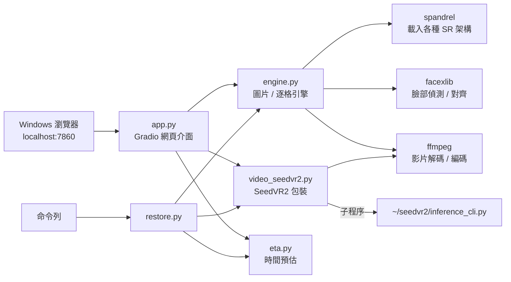

# 程式架構導讀

本文帶你讀懂每個檔案，以及背後的設計理由，適合想修改程式、加入新模型，或拿這個專案做課堂作業的人。

## 整體架構



所有程式都在 **WSL 內**執行；Windows 端只負責用瀏覽器顯示介面（WSL2 會自動把 `localhost` 轉發到 Windows）。

---

## engine.py：圖片 / 逐格引擎

### 模型登錄

```python
SR_MODELS = [ModelInfo("photo-best", "真實照片・最高品質 (DAT2)", url, 說明), ...]
FACE_MODELS, PRE_MODELS, AUX_MODELS
```

`ModelInfo` 只記錄代號、顯示名稱、下載網址與說明。**要加新模型，通常只需要在 `SR_MODELS` 加一行**：spandrel 會從權重檔自動判斷架構（支援 ESRGAN、SwinIR、HAT、DAT、DRCT、ATD、PLKSR 等數十種），不需要寫網路定義。

### `download()`：多連線下載

1. 先送 HEAD 請求，取得重新導向後的網址與檔案大小
2. 伺服器支援 `Range` 且檔案大於 8 MB 時，切成 8 段、8 個執行緒同時下載，各自寫入檔案的不同位置
3. 每段失敗最多重試 8 次，從中斷處接續
4. 先寫入 `檔名.<PID>.part`，完成後以 `os.replace` 原子性地改名，避免多個程序同時下載時互相覆蓋

### `load()`：載入模型與選擇精度

```
spandrel 讀檔 → eval 模式、關閉梯度 → 移到 GPU
→ 依序試 FP16、BF16（_try_dtype 用 128×128 隨機影像實際跑一次，檢查不出錯且無 NaN）
→ 都失敗就用 FP32
```

臉部模型固定用 FP32（內部有 FP32 運算，與半精度權重衝突）。同一類型（放大 / 臉部 / 前處理）只保留一個模型在記憶體，避免 8GB VRAM 被佔滿。

### `run_tiled()`：分塊推論

原理見 [principles.md §8.1](principles.md#81-分塊推論與羽化混合)。重點程式邏輯：

```python
for y0 in ys:
    for x0 in xs:
        patch = desc(x[:, :, y0:y1, x0:x1])          # 推論一塊
        wm = ramp_y[:, None] * ramp_x[None, :]       # 2D 羽化權重
        out[..., 放大後座標] += patch * wm
        wsum[..., 放大後座標] += wm
return out / wsum
```

外層有 `while True` 包住：捕捉 `torch.OutOfMemoryError` 時清掉快取、分塊減半再重試。這要搭配檔案開頭的 `torch.cuda.set_per_process_memory_fraction(0.92)` 才有用；否則在 WSL 下記憶體不足不會報錯，而是默默溢出變慢。

`auto_tile()` 依「剩餘 VRAM ＋ PyTorch 快取中可重用的部分」與架構類型（Transformer 較吃記憶體）決定初始分塊大小，數值來自 [experiments.md 實驗 8](experiments.md#實驗-8圖片模型的分塊與精度)。

### `restore_faces()`：臉部修復

1. `FaceRestoreHelper` 在**原圖**上偵測人臉並對齊到 512×512
2. 每張臉轉成 [-1, 1] 範圍，送進 CodeFormer（可帶 `weight=fidelity`）或 GFPGAN
3. 輸出轉回 [0, 255]，交給 helper 以反仿射加分割遮罩貼回**已放大的影像**

偵測在原圖上做、貼回在放大圖上做，所以 helper 的 `upscale_factor` 設為兩者寬度比。

### `restore_image()`：完整圖片流程

```
讀入（支援灰階、RGBA、16-bit）→ [前處理 SCUNet/FBCNN] → 放大模型（4 倍）
→ [縮放到目標倍率：縮小用 INTER_AREA、放大用 LANCZOS] → [臉部修復]
→ 透明通道另外用 Lanczos 放大後合回
```

### `restore_video()`：逐格影片管線

用兩個 ffmpeg 子程序串成管線，不在硬碟寫暫存影格：

```
ffmpeg 解碼 ──raw BGR 位元組──▶ Python 逐格 restore_image ──raw BGR──▶ ffmpeg 編碼 (x264)
                                                                    ▲
                                        原始檔案的音軌 ──複製──────────┘
```

處理影片時開啟 `cudnn.benchmark`（每格尺寸相同，自動調校卷積演算法有幫助）；處理圖片時關閉（尺寸多變時每次都要重新調校，反而更慢）。

---

## video_seedvr2.py：SeedVR2 包裝

SeedVR2 本身是獨立的 CLI 程式（[numz/ComfyUI-SeedVR2_VideoUpscaler](https://github.com/numz/ComfyUI-SeedVR2_VideoUpscaler)），這個檔案負責：

| 函式 | 功能 |
|---|---|
| `upscale()` | 組合 CLI 參數、以子程序執行、逐行解析輸出、合併音訊 |
| `auto_batch()` | 依解析度選每批影格數（720p→21、1080p→13、更高→5） |
| `attention_mode()` | 有安裝 FlashAttention 就用 `flash_attn_2`，否則 `sdpa` |
| `stop()` | 終止正在執行的子程序（網頁「停止」按鈕） |

**進度解析**：CLI 會印出 `Encoding batch 3/11`、`Upscaling batch 5/11`、`Chunk 2/40` 這類文字，以正規表達式抓出來，依各階段實測的時間比例（編碼 12%、修復 63%、解碼 25%）換算成 0~1 的進度。

**為什麼用子程序而不是直接 import？** SeedVR2 有自己的模型快取、記憶體管理與相依套件版本需求，放在獨立程序中可以：(1) 結束後完整釋放 VRAM；(2) 不和 `engine.py` 已載入的模型搶記憶體；(3) 隨時 `kill` 停止。

**音訊**：SeedVR2 輸出沒有聲音，完成後用 ffmpeg 把原影片的音軌（轉 AAC）合併回去，影像串流直接複製不重新編碼。

---

## eta.py：時間預估

| 函式 | 功能 |
|---|---|
| `estimate_seed()` / `estimate_frame()` | 回傳 (預估秒數, 速度鍵, 工作量) |
| `rate()` | 讀取速率：優先用 `outputs/.speed.json` 的實測值，否則用預設值 |
| `record()` | 完成後以指數平均更新速率 |
| `Live.remaining()` | 執行中依「已過時間 ÷ 進度」推算剩餘時間 |
| `fmt()` | 把秒數轉成「3 小時 5 分」、「2 天 4 小時」 |

模型設計與驗證見 [experiments.md](experiments.md#處理時間預估模型)。

---

## app.py：網頁介面

使用 [Gradio](https://www.gradio.app/) 6。結構：

- 上方：標題與 GPU 狀態（`engine.system_info()`）
- **影片分頁**：左欄設定（依引擎切換顯示 SeedVR2 或逐格的參數群組）、右欄輸入 / 輸出影片、預估資訊、開始 / 停止按鈕
- **圖片分頁**：左欄設定、右欄單張（`ImageSlider` 前後對比）與批次子分頁

重要的事件設定：

```python
demo.queue(default_concurrency_limit=1)        # GPU 一次只跑一個任務
comp.change(video_estimate, ..., concurrency_limit=None)   # 預估不用排隊，影片處理中也能即時更新
stop_btn.click(stop_video, ..., concurrency_limit=None)    # 停止按鈕不能排在要停止的任務後面
```

每個參數都有 `info=` 說明文字，會顯示在元件下方。

---

## restore.py：命令列

與網頁介面共用 `engine`、`video_seedvr2`、`eta`。依副檔名分流圖片 / 影片；輸入是資料夾時保留子資料夾結構輸出。完整參數見 `./run.sh --help`。

---

## 課堂練習建議

1. **加入新模型**：從 [OpenModelDB](https://openmodeldb.info/) 找一個 4x 模型，加到 `SR_MODELS`，比較它和 `photo-best` 的速度與畫質。
2. **分塊實驗**：用 `--tile 128 / 256 / 512` 處理同一張大圖，量測時間與 VRAM，並觀察 `overlap=0` 時的接縫。
3. **精度實驗**：修改 `load()` 強制使用 FP32 / FP16 / BF16，比較速度與輸出差異（例如計算 PSNR）。
4. **閃爍觀察**：同一段影片分別用逐格模式與 SeedVR2 處理，逐格比對相鄰影格的差異。
5. **批次大小與一致性**：用 SeedVR2 每批 5、13、21 格處理同一段影片，觀察時間一致性與速度的取捨。
6. **Amdahl 定律**：從 SeedVR2 的 `--debug` 日誌找出各階段耗時，計算只加速 DiT 階段的理論上限。
